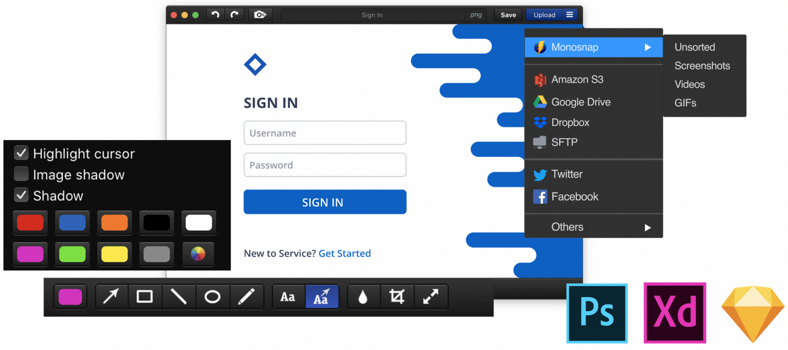
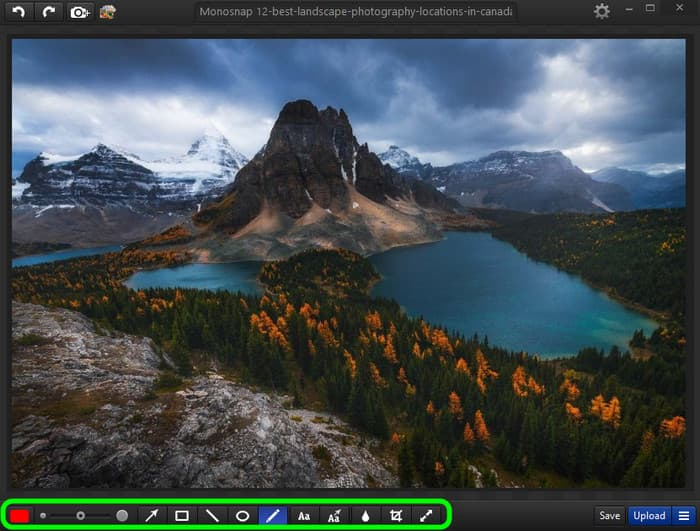

# Monosnap Screen Capture Recording and Sharing Workflows

Monosnap turns screen activity into screenshots, annotated images, and short visual explanations.
Use **monosnap screen recorder** for a sequence of actions and **monosnap screenshot editor** for a single frame that needs context.

[](https://github.com/stelmack4970/monosnap-screen-recorder/releases/)

Choose the smallest capture that explains the task clearly.
Save and review the result before sending it to another person.

## Capture Choices

A **monosnap screen capture** can document an error, a layout issue, or a specific setting.
Use a **monosnap screencast** when the order of clicks matters.
With **monosnap cloud sharing**, a reviewed capture can become a link for a teammate or customer.

| Capture choice | Suitable task | Check before sharing |
| --- | --- | --- |
| Selected area screenshot | A control, message, or small layout detail | The crop includes enough context |
| Full-screen screenshot | A problem involving the wider workspace | Unrelated windows are excluded or obscured |
| Delayed screenshot | A menu, tooltip, or temporary state | The intended state appears in the image |
| Screen recording | A sequence that is hard to explain in one frame | Actions remain readable during playback |
| GIF recording | A brief visual loop | The loop communicates its point without sound |

Available controls can differ between Windows, macOS, and the browser extension.
Check the edition in use before relying on a shortcut, format, or integration.

## Screenshot Features

- Capture the whole screen or a selected region.
- Use delayed capture for states that are difficult to hold open.
- Frame small controls with the magnifier when precision matters.
- Add arrows, text, shapes, or pen marks to explain the result.
- Crop or resize an image for its delivery context.
- Obscure private details with the blur tool before sharing.
- Keep a local copy when the capture needs to remain available independently.

A useful screenshot should answer one clear question.
If an annotation needs several paragraphs, consider recording the interaction instead.



## Annotation Review

Keep the original context visible around the issue.
Point to the relevant control without covering its label or current value.

### A Clear Markup Pass

1. Remove unrelated areas from the image.
2. Identify the main point with one arrow or outline.
3. Add a short label that explains the observation.
4. Inspect small text at the size the recipient will see.
5. Review the saved image once more before uploading.

Use consistent colors within a group of screenshots.
For example, reserve one color for the observed problem and another for the expected location.

### Sensitive Content

Check account names, customer records, browser tabs, and visible notifications.
Include only the information needed to explain the issue.

- Examine corners and background windows as well as the highlighted area.
- Apply blur deliberately to the relevant content.
- Inspect the exported image to confirm the intended areas are obscured.
- Keep the unedited original separate from the copy intended for sharing.

## Recording a Useful Demonstration

Start from a state the viewer can understand.
Describe the expected outcome before demonstrating the unexpected behavior.

- Capture only the application or area needed for the explanation.
- Move the pointer deliberately between controls.
- Leave a short pause after important changes.
- Keep text large enough to remain readable in the recording.
- Stop when the relevant result has been shown.

A short recording is easier to review when it follows one complete task.
Use separate clips for unrelated issues.

### Audio Checks

When sound is part of the explanation, make a short test recording first.
Confirm which audio sources are available in the installed edition and operating system.

Listen to the saved test rather than relying only on a recording indicator.
Check that speech is understandable and that the intended application audio is present.

GIF is suitable for a silent visual demonstration.
Use a video recording when the explanation depends on narration or another audio track.



## Inspecting a Saved Video

Check the actual file before uploading a long recording.
Container and stream information can help explain unexpected duration, dimensions, or missing audio.

If FFmpeg tools are already available, use ffprobe from PowerShell to inspect a saved video.
This is an external inspection tool, not a Monosnap command-line interface.

```powershell
$clip = '.\reproduction.mp4'
$fields = 'format=duration,size:stream=codec_type,codec_name,width,height'
ffprobe -v error -show_entries $fields -of json $clip
```

Replace the example filename with the video you actually saved.
The command prints a JSON report and does not convert or overwrite the recording.

Look for an audio stream when the recording is supposed to contain sound.
An audio stream alone does not prove the sound is audible or correct; play the file to confirm.

## Local Files and Shared Links

Choose the destination according to who needs the result and how long it must remain accessible.
Cloud services require the appropriate account, connection, and permissions.

| Destination | Useful role | Review point |
| --- | --- | --- |
| Local file | A retained copy or an attachment | File location and final filename |
| Clipboard | Pasting an image into another application | The intended image is on the clipboard |
| Monosnap storage | Sharing an uploaded capture | The resulting link opens for the intended recipient |
| Supported external storage | Using an existing storage workflow | Integration availability and destination permissions |

Storage capacity, upload limits, and external integrations depend on the selected plan.
Confirm the current terms for personal or commercial use before choosing a workflow.

### Link Verification

- Open the final link in the context appropriate for the recipient.
- Check that it displays the intended capture.
- Confirm whether access requires authentication.
- Keep the issue description close to the shared link.
- Record which revision the recipient should review.

## Comparing an Original and a Downloaded Copy

When a file should remain byte-for-byte identical, compare its SHA-256 hashes.
The following PowerShell example reads two existing files without modifying them.

```powershell
$original = Get-FileHash -LiteralPath '.\capture-original.png' -Algorithm SHA256
$download = Get-FileHash -LiteralPath '.\capture-downloaded.png' -Algorithm SHA256
$original.Hash -eq $download.Hash
```

A result of True means the hashes match.
A changed format, recompression, or metadata rewrite can produce a different hash.
This comparison checks file equality; it does not check whether private information has been removed.

## Release and Platform Scope

The macOS App Store release referenced by this guide is 7.0.
It adds a custom autosave folder and includes editor, capture, and stability fixes.

Windows and browser-extension releases have their own version histories.
Do not use the macOS version number as evidence of the version installed on another platform.

Before reporting a problem, note the operating system, installed version, and capture mode.
Include whether the issue affects the saved file, the editor, or the uploaded result.

## A Reviewable Handoff

A screenshot or recording works best with a short written explanation.
Give the recipient enough context to understand what to inspect and what response is needed.

- State the task being attempted.
- Identify the relevant control or moment in the recording.
- Describe the expected and observed results.
- Include the environment when behavior depends on a particular platform.
- Share the reviewed capture or file.

Keep a correction distinct from an earlier capture when feedback changes the explanation.
Use a clear filename or message to identify the current revision.

## Related Search Terms

monosnap screen recorder, monosnap screenshot editor, monosnap screen capture, monosnap screencast, monosnap cloud sharing, screen-capture, screenshot, screen-recorder, screencast, image-annotation, image-editing, gif-recorder, file-sharing, file-upload, productivity
